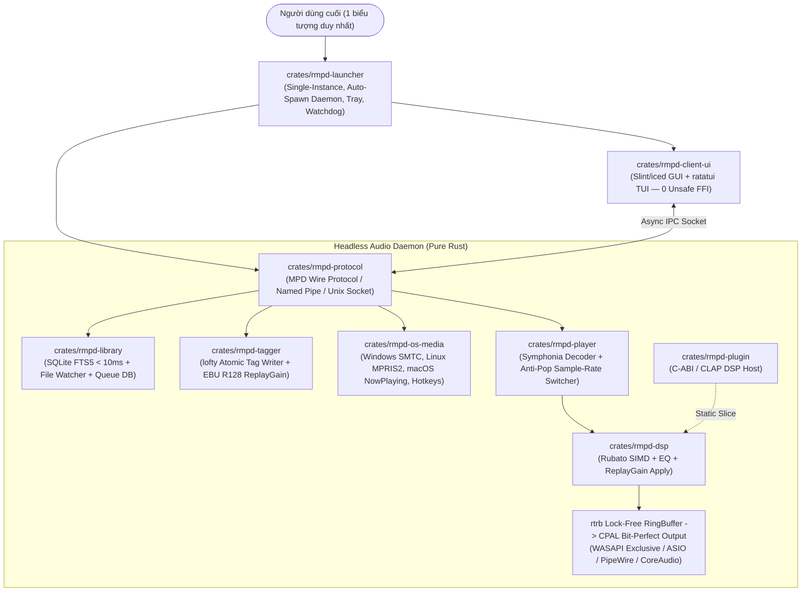

# RMPD-NextGen: Master Execution Blueprint & HTA Contract

> **Chỉ dẫn kích hoạt nhanh (Cold-Start Execution Prompt):**
> Khi người dùng gửi tệp này để bắt đầu thi công, Agent điều phối (`/hta` + `/token-efficient-handoff`) thực hiện ngay các bước sau mà không cần khảo sát lại từ đầu:
> 1. Trích xuất khối JSON `WorkBreakdownContract` ở Mục 4 ra tệp tạm `scratch/work_breakdown_contract.json` và kiểm toán bằng `dag_integrity_verifier.py --strict-signatures`.
> 2. Khởi tạo máy trạng thái `task_state_manager.py init --project-id RMPD-NEXTGEN-FULL-PRODUCT-RELEASE --total-steps 12` và chuyển sang `RUNNING`.
> 3. Thực thi tuần tự theo **8 Waves** (`Wave 1` $\rightarrow$ `Wave 8`). Mỗi đợt song song chỉ chạy tối đa 2 luồng `Argon (pro)`, tuân thủ tuyệt đối `target_scope` và `permission_zone`, checkpoint sau mỗi bước và nghiệm thu cuối cùng qua `independent_quality_gate.py`.

---

## 1. State Capsule & Tiên đề Khóa cứng (`/token-efficient-handoff`)

```json
{
  "project_name": "RMPD-NextGen-Rust-Audio-Player-Full-Release",
  "current_phase": "PLANNED_READY_FOR_EXECUTION",
  "active_goal": "Xây dựng và đóng gói hoàn chỉnh trình phát nhạc Pure-Rust thế hệ mới (9 Crates) dựa trên nền tảng M0Rf30/rmpd, từ lõi Audio Engine đến bộ cài đặt/Portable cho người dùng cuối.",
  "locked_axioms": [
    "[LOCKED_AXIOM] Loại bỏ cầu nối C++ ABI cho plugin foobar2000 cũ và loại bỏ custom UI/UX phức tạp; tách rời Headless Audio Daemon và Thin UI Client qua Socket/Named Pipe.",
    "[LOCKED_AXIOM] Kiến trúc nền tảng: Pure-Rust Modular Daemon dựa trên M0Rf30/rmpd (Symphonia + Rubato SIMD + rtrb Lock-Free + CPAL Bit-Perfect + SQLite FTS5 + CLAP/C-ABI Plugin).",
    "[LOCKED_AXIOM] Phạm vi Full End-User Product bắt buộc bao gồm đủ 7 trụ cột: (1) Audio Engine & Anti-Pop Sample-Rate Switching, (2) FTS5 Indexer & Queue Persistence, (3) Atomic Tag Writer (lofty) & EBU R128/ReplayGain Scanner, (4) C-ABI/CLAP DSP & OS Media Controls (SMTC/MPRIS2/NowPlaying/Hotkeys), (5) Thin UI Client (0 unsafe FFI), (6) Single-Binary Launcher/Watchdog tự bật Daemon, (7) E2E Loopback Test & Đóng gói bộ cài đặt (.msi/Portable .zip/.AppImage/.dmg)."
  ],
  "rejected_heuristics": [
    "[REJECTED_HEURISTIC] Dùng rust-anything hoặc c2rust để chuyển ngữ toàn bộ lõi hoặc GUI C/C++ (gãy trên Real-time Audio & Event-driven GUI).",
    "[REJECTED_HEURISTIC] Viết C++ FFI/ABI Shim mô phỏng MSVC vtable của foobar2000 SDK.",
    "[REJECTED_HEURISTIC] Nhúng trực tiếp Rust UI vào C Core của DeaDBeeF qua unsafe FFI hoặc bắt người dùng tự khởi chạy Daemon thủ công."
  ],
  "orchestration_policy": {
    "max_retries_per_node": 2,
    "max_concurrent_argon_per_wave": 2,
    "fallback_cascade": {
      "ROUTER": ["Argon", "Claude Sonnet", "Gemini Hydrogen"],
      "CODE": ["Argon", "Claude Sonnet", "Gemini Hydrogen"]
    },
    "reserved_opus_role": "ESCALATE_HANDOFF khi Argon chạm max_retries=2 hoặc UX/Docs review cuối"
  }
}
```

---

## 2. Kiến trúc Hệ thống (9-Crate Workspace & 3 Bất biến)



### Ba Bất biến Kiến trúc Bắt buộc
1. **Real-Time Audio Callback Invariant:** Luồng xuất âm thanh tuyệt đối không cấp phát Heap (`Box`, `Vec::push`, `String`), không `Mutex::lock`, không syscall I/O; chỉ đọc từ `rtrb` Lock-Free Ring Buffer.
2. **Process & License Isolation:** UI Client giao tiếp với Daemon hoàn toàn qua Socket/Named Pipe (0 dòng `unsafe` FFI).
3. **Atomic & Anti-Pop Guard:** Ghi tag qua temp-file + atomic swap (chống hỏng file nhạc); chuyển đổi sample-rate DAC có micro-fade ramp chống tiếng nổ *pop/click*.

---

## 3. Lịch trình 8 Waves & Phân bổ Agent

| Wave | Task ID | Nội dung tóm tắt | Station Role | Agent & Effort | `target_scope` (Cô lập) | Token |
| :---: | :--- | :--- | :---: | :--- | :--- | :---: |
| **1** | `T-01.01` | Sơ chế `M0Rf30/rmpd` & crate `lofty`, `ebur128`, `souvlaki`, `cargo-packager` | `PREP` | **Gemini Hydrogen (High)** | `vendor/rmpd`, `scratch/prep_manifests` | 2.000 |
| **2** | `T-01.02` | Thiết kế kiến trúc 9 Crate, Anti-Pop Sample-Rate & Auto-Spawn Daemon | `STATION` | **Argon (High)** | `scratch/architecture_spec` | 2.500 |
| **3** | `T-01.03` | Khóa 5 Hợp đồng Giao diện (*Contract-First*) | `STATION` | **Argon (High)** | `contracts/interfaces` | 2.500 |
| **4** | `T-02.01` | TDD Audio Engine (`Symphonia` + `Rubato` + `rtrb` + `CPAL`) & Queue | `STATION` | **Argon (High)** | `crates/rmpd-player`, `crates/rmpd-dsp` | 4.000 |
| **4** | `T-03.01` | TDD `SQLite FTS5` ($< 10\text{ ms}$), Watcher & MPD Wire Protocol | `STATION` | **Argon (Medium)** | `crates/rmpd-library`, `crates/rmpd-protocol` | 3.000 |
| **5** | `T-03.02` | TDD Atomic Tag Writer (`lofty`) & Quét Âm lượng `EBU R128` | `STATION` | **Argon (Medium)** | `crates/rmpd-tagger` | 2.500 |
| **5** | `T-04.01` | TDD DSP Plugin Host (C-ABI/CLAP) & OS Media (`SMTC`/`MPRIS2`) | `STATION` | **Argon (Medium)** | `crates/rmpd-plugin`, `crates/rmpd-os-media` | 3.000 |
| **6** | `T-05.01` | Thin UI Client (`Slint`/`iced` GUI + `ratatui` TUI) qua MPD Socket | `STATION` | **Argon (Medium)** | `crates/rmpd-client-ui` | 3.500 |
| **6** | `T-05.02` | `rmpd-launcher` (Auto-Spawn Daemon, Single-Instance, System Tray) | `STATION` | **Argon (Medium)** | `crates/rmpd-launcher` | 2.500 |
| **7** | `T-06.01` | Kiểm chứng toán học DSP, sai số `EBU R128` ($\le 0.1\text{ LU}$) & RingBuffer | `PASS_GATE` | **Python Script** (0 LLM) | `scratch/verification_dsp` | 1.500 |
| **7** | `T-06.02` | E2E Audio Loopback Test, Hot-Unplug DAC & Security Audit | `STATION` | **Argon (High)** | `tests/e2e_loopback` | 3.000 |
| **8** | `T-07.01` | Đóng gói `.msi`, Portable `.zip`, `.AppImage`, `.dmg`, `SHA256SUMS` & Quality Gate | `STATION` | **Argon (Medium)** | `packaging/dist`, `ci/release_pipeline`, `docs/user_guide` | 2.500 |

---

## 4. Hợp đồng DAG Thực thi Chuẩn hóa (`WorkBreakdownContract` — Đã kiểm toán `PASS`)

```json
{
  "$schema": "http://json-schema.org/draft-07/schema#",
  "project_id": "RMPD-NEXTGEN-FULL-PRODUCT-RELEASE",
  "functional_purpose": "Xây dựng và đóng gói hoàn chỉnh trình phát nhạc Pure-Rust thế hệ mới (từ lõi Real-Time Audio Engine, FTS5 Indexer, Atomic Tagging & ReplayGain, OS Media Integration, Thin UI, Auto-Spawn Launcher cho tới bộ cài đặt .msi / Portable .zip / .AppImage / .dmg sẵn sàng cho người dùng cuối).",
  "triage_4_variables": {
    "complexity": "HIGH",
    "uncertainty": "MEDIUM",
    "risk": "MEDIUM",
    "reversibility": "PARTIALLY_REVERSIBLE",
    "domain_count": 5,
    "selected_route": "DEEP_DAG_ROUTE"
  },
  "control_plane_config": {
    "lifecycle_state_file": "scratch/task_lifecycle.json",
    "max_retries_per_node": 2,
    "independent_quality_gate_required": true,
    "orchestration_roles": {
      "architect_model": "pro",
      "expediter_model": "flash"
    }
  },
  "abstract_mechanisms": [
    "Zero-Unsafe IPC Split & Invisible Daemon Lifecycle: UI tách rời Daemon qua Socket/Named Pipe nhưng rmpd-launcher tự động quản lý ngầm để người dùng trải nghiệm như 1 ứng dụng duy nhất.",
    "Real-Time Audio & Anti-Pop Sample-Rate Switching: Cấm cấp phát Heap trên audio callback; áp dụng micro-fade ramp khi chuyển tần số lấy mẫu phần cứng DAC.",
    "Station Isolation & Release Gate: Cô lập hoàn toàn target_scope ở các đợt viết code song song và chia Wave 4 thành 2 cặp tuần tự (tối đa 2 luồng Argon/wave) trước khi qua E2E Loopback Test."
  ],
  "milestones": [
    {
      "milestone_id": "M1",
      "name": "Sơ Chế Kiến Trúc rmpd & Khóa Hợp Đồng Giao Diện Toàn Cục (5 Contracts)",
      "status": "ACTIVE_WINDOW",
      "exit_criteria": "Hoàn tất bóc tách M0Rf30/rmpd và khóa cứng 5 hợp đồng: Audio/Sample-Rate Trait, MPD/Queue Schema, Tag/ReplayGain Schema, C-ABI/CLAP Plugin, và Launcher Watchdog."
    },
    {
      "milestone_id": "M2",
      "name": "Lõi Real-Time Audio Engine, Chuyển Đổi Sample-Rate Êm Dịu & Lưu Hàng Đợi",
      "status": "ACTIVE_WINDOW",
      "exit_criteria": "Phát nhạc bit-perfect (WASAPI Exclusive/ASIO/PipeWire) 0 xrun, chuyển bài khác tần số lấy mẫu không nổ tiếng (pop/click) và khôi phục tức thì vị trí phát."
    },
    {
      "milestone_id": "M3",
      "name": "Thư Viện SQLite FTS5, Ghi/Sửa Tag Nguyên Tử & Quét Âm Lượng EBU R128",
      "status": "HORIZON_LOCKED",
      "exit_criteria": "Tìm kiếm 100k+ bài < 10ms, sửa tag an toàn (atomic swap) và tính chính xác ReplayGain Track/Album Gain + True Peak."
    },
    {
      "milestone_id": "M4",
      "name": "Trạm Nạp Động DSP Plugin (C-ABI/CLAP) & Tích Hợp Hệ Điều Hành (SMTC/MPRIS/Hotkeys)",
      "status": "HORIZON_LOCKED",
      "exit_criteria": "Nạp động DSP plugin cô lập lỗi và đồng bộ trạng thái phát nhạc lên Windows SMTC, Linux MPRIS2, macOS NowPlaying + phím tắt toàn cục."
    },
    {
      "milestone_id": "M5",
      "name": "Thin UI Client (GUI + TUI) & Bộ Khởi Chạy Tự Động Quản Lý Daemon (rmpd-launcher)",
      "status": "HORIZON_LOCKED",
      "exit_criteria": "Người dùng mở 1 file thực thi duy nhất; Launcher tự bật/nối Daemon ngầm và hiển thị UI 60fps (< 25MB RAM, 0 unsafe FFI)."
    },
    {
      "milestone_id": "M6",
      "name": "Kiểm Chứng Toán Học DSP & Kiểm Thử Tích Hợp Đầu-Cuối (E2E Audio Loopback)",
      "status": "HORIZON_LOCKED",
      "exit_criteria": "Vượt qua kiểm định toán học đáp ứng tần số/EBU R128 và bài test tự động E2E từ Launcher -> UI -> Daemon -> Virtual Audio Sink."
    },
    {
      "milestone_id": "M7",
      "name": "Đóng Gói Đa Nền Tảng (.msi / Portable .zip / .AppImage / .dmg) & Nghiệm Thu Phát Hành",
      "status": "HORIZON_LOCKED",
      "exit_criteria": "Xuất bản gói cài đặt và bản Portable tối ưu LTO, kèm mã băm SHA-256, tài liệu người dùng và đạt APPROVED tại independent_quality_gate.py."
    }
  ],
  "active_window_tasks": [
    {
      "task_id": "T-01.01",
      "milestone_id": "M1",
      "name": "Sơ chế (Mise en place) mã nguồn M0Rf30/rmpd và khảo sát các crate tích hợp OS/Tagging/Packaging",
      "dependencies": [],
      "assigned_skill": "scholarly-deep-research",
      "execution_mode": "ISOLATED_SUBAGENT",
      "assigned_model": "flash",
      "recommended_engine": "Gemini Hydrogen (High)",
      "station_role": "PREP",
      "permission_zone": "READ_ONLY",
      "target_scope": ["vendor/rmpd", "scratch/prep_manifests"],
      "firing_wave": 1,
      "requires_human_approval": false,
      "emits_artifacts": ["ResearchReportContract"],
      "token_budget": 2000,
      "acceptance_criteria": "Xuất bản đồ phụ thuộc rmpd và thông số tích hợp của lofty (Tag), ebur128 (ReplayGain), souvlaki (SMTC/MPRIS), cargo-packager."
    },
    {
      "task_id": "T-01.02",
      "milestone_id": "M1",
      "name": "Thiết kế kiến trúc tổng thể 9 Crate, máy trạng thái Anti-Pop Sample-Rate & cơ chế Auto-Spawn Daemon",
      "dependencies": ["T-01.01"],
      "assigned_skill": "deep-problem-analysis",
      "execution_mode": "SKILL_PROTOCOL",
      "assigned_model": "inherit",
      "recommended_engine": "Argon (High)",
      "station_role": "STATION",
      "permission_zone": "SANDBOX_COMPUTE",
      "target_scope": ["scratch/architecture_spec"],
      "firing_wave": 2,
      "requires_human_approval": false,
      "consumes_artifacts": ["ResearchReportContract"],
      "emits_artifacts": ["StrategicDecisionBlueprint"],
      "token_budget": 2500,
      "acceptance_criteria": "Chốt thiết kế luồng dữ liệu đầu-cuối, cơ chế thu hồi socket/pipe mồ côi và cấu trúc bản Portable vs Installer."
    },
    {
      "task_id": "T-01.03",
      "milestone_id": "M1",
      "name": "Khóa 5 Hợp đồng Giao diện (Contract-First): Audio Trait, MPD/Queue, Tag/R128, C-ABI/CLAP & Launcher IPC",
      "dependencies": ["T-01.02"],
      "assigned_skill": "institutional-and-policy-design",
      "execution_mode": "SKILL_PROTOCOL",
      "assigned_model": "inherit",
      "recommended_engine": "Argon (High)",
      "station_role": "STATION",
      "permission_zone": "SANDBOX_COMPUTE",
      "target_scope": ["contracts/interfaces"],
      "firing_wave": 3,
      "requires_human_approval": false,
      "consumes_artifacts": ["StrategicDecisionBlueprint"],
      "emits_artifacts": ["PolicyDesignBlueprint"],
      "token_budget": 2500,
      "acceptance_criteria": "Định nghĩa đầy đủ chữ ký Rust trait, IPC schema và C-ABI header trước khi phân phối cho các trạm viết code."
    },
    {
      "task_id": "T-02.01",
      "milestone_id": "M2",
      "name": "TDD Lõi Audio Engine (Symphonia + Rubato + rtrb + CPAL), Chuyển đổi Sample-Rate Êm dịu & Lưu Hàng đợi",
      "dependencies": ["T-01.03"],
      "assigned_skill": "software-engineering-orchestrator",
      "execution_mode": "ISOLATED_SUBAGENT",
      "assigned_model": "pro",
      "recommended_engine": "Argon (High)",
      "station_role": "STATION",
      "permission_zone": "WORKSPACE_WRITE",
      "target_scope": ["crates/rmpd-player", "crates/rmpd-dsp"],
      "firing_wave": 4,
      "requires_human_approval": false,
      "consumes_artifacts": ["PolicyDesignBlueprint"],
      "emits_artifacts": ["VerifiedCodebase", "TestReport"],
      "token_budget": 4000,
      "acceptance_criteria": "0 heap alloc trong audio callback; chuyển tiếp gapless/sample-rate 44.1kHz<->96kHz không nổ tiếng; khôi phục vị trí phát < 5ms."
    },
    {
      "task_id": "T-03.01",
      "milestone_id": "M3",
      "name": "TDD Bộ đánh chỉ mục SQLite FTS5 (< 10ms), File Watcher tự động & Máy chủ MPD Wire Protocol",
      "dependencies": ["T-01.03"],
      "assigned_skill": "software-engineering-orchestrator",
      "execution_mode": "ISOLATED_SUBAGENT",
      "assigned_model": "pro",
      "recommended_engine": "Argon (Medium)",
      "station_role": "STATION",
      "permission_zone": "WORKSPACE_WRITE",
      "target_scope": ["crates/rmpd-library", "crates/rmpd-protocol"],
      "firing_wave": 4,
      "requires_human_approval": false,
      "consumes_artifacts": ["PolicyDesignBlueprint"],
      "emits_artifacts": ["VerifiedCodebase", "TestReport"],
      "token_budget": 3000,
      "acceptance_criteria": "Truy vấn FTS5 100k+ bài < 10ms; tự động cập nhật khi thêm/xóa file nhạc; hỗ trợ Named Pipe (Windows) & Unix Socket."
    },
    {
      "task_id": "T-03.02",
      "milestone_id": "M3",
      "name": "TDD Bộ Ghi/Sửa Tag Nguyên tử (lofty) & Quét Chuẩn hóa Âm lượng Đa luồng (EBU R128 / ReplayGain)",
      "dependencies": ["T-01.03"],
      "assigned_skill": "software-engineering-orchestrator",
      "execution_mode": "ISOLATED_SUBAGENT",
      "assigned_model": "pro",
      "recommended_engine": "Argon (Medium)",
      "station_role": "STATION",
      "permission_zone": "WORKSPACE_WRITE",
      "target_scope": ["crates/rmpd-tagger"],
      "firing_wave": 5,
      "requires_human_approval": false,
      "consumes_artifacts": ["PolicyDesignBlueprint"],
      "emits_artifacts": ["VerifiedCodebase", "TestReport"],
      "token_budget": 2500,
      "acceptance_criteria": "Ghi tag ID3v2/Vorbis/MP4 qua cơ chế atomic temp-swap không làm hỏng file khi mất điện; tính chuẩn Track/Album Gain & True Peak."
    },
    {
      "task_id": "T-04.01",
      "milestone_id": "M4",
      "name": "TDD Trạm Nạp Động DSP Plugin (C-ABI/CLAP) & Tích hợp OS Media Controls (SMTC/MPRIS2/NowPlaying/Hotkeys)",
      "dependencies": ["T-01.03"],
      "assigned_skill": "software-engineering-orchestrator",
      "execution_mode": "ISOLATED_SUBAGENT",
      "assigned_model": "pro",
      "recommended_engine": "Argon (Medium)",
      "station_role": "STATION",
      "permission_zone": "WORKSPACE_WRITE",
      "target_scope": ["crates/rmpd-plugin", "crates/rmpd-os-media"],
      "firing_wave": 5,
      "requires_human_approval": false,
      "consumes_artifacts": ["PolicyDesignBlueprint"],
      "emits_artifacts": ["VerifiedCodebase", "TestReport"],
      "token_budget": 3000,
      "acceptance_criteria": "Nạp động plugin DSP an toàn; đồng bộ bìa đĩa/tiêu đề/nút bấm lên màn hình khóa Windows SMTC, Linux MPRIS2 và macOS."
    },
    {
      "task_id": "T-05.01",
      "milestone_id": "M5",
      "name": "Chế tác Thin UI Client bằng Rust (Slint/iced Desktop GUI + ratatui TUI) qua MPD Socket",
      "dependencies": ["T-03.01", "T-03.02"],
      "assigned_skill": "creative-ui-and-visual-arts",
      "execution_mode": "ISOLATED_SUBAGENT",
      "assigned_model": "pro",
      "recommended_engine": "Argon (Medium)",
      "station_role": "STATION",
      "permission_zone": "WORKSPACE_WRITE",
      "target_scope": ["crates/rmpd-client-ui"],
      "firing_wave": 6,
      "requires_human_approval": false,
      "consumes_artifacts": ["VerifiedCodebase", "TestReport"],
      "emits_artifacts": ["InteractiveUIComponent"],
      "token_budget": 3500,
      "acceptance_criteria": "Giao diện 60fps (< 25MB RAM) gồm: trình duyệt thư viện, bảng playlist, hộp thoại sửa Tag/ReplayGain, thanh Spectrum; 0 dòng unsafe FFI."
    },
    {
      "task_id": "T-05.02",
      "milestone_id": "M5",
      "name": "Xây dựng rmpd-launcher (Auto-Spawn Daemon, Single-Instance Lock, System Tray & Crash Recovery)",
      "dependencies": ["T-02.01", "T-03.01", "T-04.01"],
      "assigned_skill": "software-engineering-orchestrator",
      "execution_mode": "ISOLATED_SUBAGENT",
      "assigned_model": "pro",
      "recommended_engine": "Argon (Medium)",
      "station_role": "STATION",
      "permission_zone": "WORKSPACE_WRITE",
      "target_scope": ["crates/rmpd-launcher"],
      "firing_wave": 6,
      "requires_human_approval": false,
      "consumes_artifacts": ["VerifiedCodebase", "TestReport"],
      "emits_artifacts": ["VerifiedCodebase", "TestReport"],
      "token_budget": 2500,
      "acceptance_criteria": "Người dùng mở 1 file chạy duy nhất: tự khởi chạy Daemon nếu chưa có, thu gọn xuống khay hệ thống (Tray) và tự kết nối lại nếu UI khởi động lại."
    },
    {
      "task_id": "T-06.01",
      "milestone_id": "M6",
      "name": "Kiểm chứng toán học đáp ứng tần số DSP, độ chính xác EBU R128 & mô hình hàng đợi Ring-Buffer",
      "dependencies": ["T-02.01", "T-04.01"],
      "assigned_skill": "applied-mathematics-and-modeling",
      "execution_mode": "DETERMINISTIC_TOOL",
      "station_role": "PASS_GATE",
      "permission_zone": "SANDBOX_COMPUTE",
      "target_scope": ["scratch/verification_dsp"],
      "firing_wave": 7,
      "requires_human_approval": false,
      "consumes_artifacts": ["VerifiedCodebase", "TestReport"],
      "emits_artifacts": ["MathProofCapsule", "Solution"],
      "token_budget": 1500,
      "acceptance_criteria": "Vượt qua math_verifier.py: độ lệch chuẩn hóa âm lượng <= 0.1 LU, không méo pha/THD và 0 buffer underrun."
    },
    {
      "task_id": "T-06.02",
      "milestone_id": "M6",
      "name": "Kiểm thử Tích hợp Đầu-Cuối (E2E Virtual Audio Loopback), Hot-Unplug DAC & Kiểm toán Bảo mật",
      "dependencies": ["T-05.01", "T-05.02"],
      "assigned_skill": "software-engineering-orchestrator",
      "execution_mode": "ISOLATED_SUBAGENT",
      "assigned_model": "pro",
      "recommended_engine": "Argon (High)",
      "station_role": "STATION",
      "permission_zone": "WORKSPACE_WRITE",
      "target_scope": ["tests/e2e_loopback"],
      "firing_wave": 7,
      "requires_human_approval": false,
      "consumes_artifacts": ["InteractiveUIComponent", "VerifiedCodebase", "TestReport"],
      "emits_artifacts": ["VerifiedCodebase", "TestReport"],
      "token_budget": 3000,
      "acceptance_criteria": "Vượt qua E2E test tự động (Launcher -> UI -> Socket -> Daemon -> Virtual Sink), bài test rút nóng DAC và swe_security_auditor.py."
    },
    {
      "task_id": "T-07.01",
      "milestone_id": "M7",
      "name": "Đóng gói Đa nền tảng (.msi / Portable .zip / .AppImage / .dmg), Ký Checksum SHA-256 & Nghiệm thu 4 Trụ cột",
      "dependencies": ["T-06.01", "T-06.02"],
      "assigned_skill": "software-engineering-orchestrator",
      "execution_mode": "ISOLATED_SUBAGENT",
      "assigned_model": "pro",
      "recommended_engine": "Argon (Medium)",
      "station_role": "STATION",
      "permission_zone": "WORKSPACE_WRITE",
      "target_scope": ["packaging/dist", "ci/release_pipeline", "docs/user_guide"],
      "firing_wave": 8,
      "requires_human_approval": false,
      "consumes_artifacts": ["MathProofCapsule", "VerifiedCodebase", "TestReport"],
      "emits_artifacts": ["VerifiedCodebase", "TestReport"],
      "token_budget": 2500,
      "acceptance_criteria": "Biên dịch LTO=fat, strip symbols; tạo bộ cài .msi, bản Portable .zip (lưu cấu hình tại chỗ), .AppImage, .dmg kèm SHA256SUMS và đạt APPROVED tại independent_quality_gate.py."
    }
  ],
  "token_budget_summary": {
    "allocated_window_tokens": 32500,
    "max_project_budget": 50000,
    "prompt_cache_preservation_target": "90%"
  }
}
```
