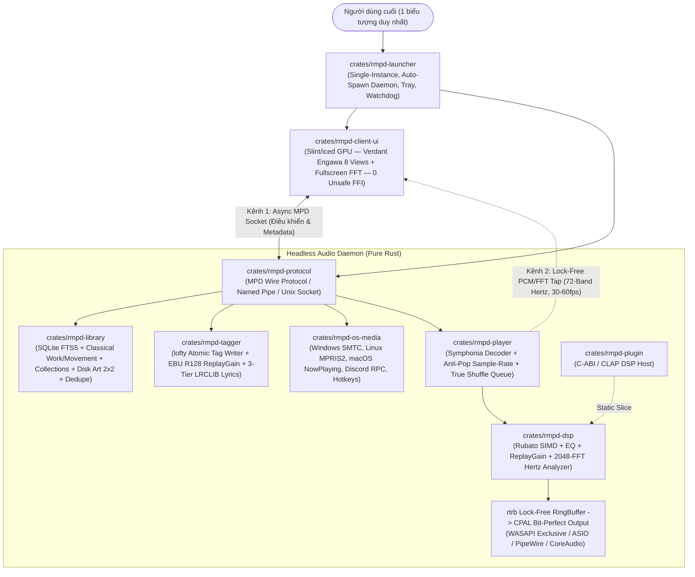

# RMPD-NextGen (Verdant Engawa Edition): Master Execution Blueprint & HTA Contract

> **Chỉ dẫn kích hoạt nhanh (Cold-Start Execution Prompt):**
> Khi người dùng gửi tệp này để bắt đầu thi công, Agent điều phối (`/hta` + `/token-efficient-handoff`) thực hiện ngay các bước sau:
> 1. Trích xuất hoặc nạp trực tiếp `.hta/work_breakdown_contract.json` và kiểm toán bằng `dag_integrity_verifier.py --strict-signatures`.
> 2. Chuyển trạng thái máy trạng thái `.hta/task_lifecycle.json` sang `RUNNING`.
> 3. Thực thi tuần tự theo **8 Waves** (`Wave 1` $\rightarrow$ `Wave 8`). Mỗi đợt song song chỉ chạy tối đa 2 luồng `Argon (pro)`, tuân thủ tuyệt đối `target_scope` và `permission_zone`, checkpoint sau mỗi bước và nghiệm thu cuối cùng qua `independent_quality_gate.py`.

---

## 1. Đối chiếu Thay đổi UI Thực tế (Local Verdant Engawa vs. Blueprint Cũ)

Bản UI thực tế đang chạy trong máy tại `C:\Users\Le Ke Hien\AppData\Roaming\foobar2000-v2\verdant` (và nhánh `feat/option-c-refactor` của `verdant-foobar2000-theme`) đã tiến hóa vượt xa mô tả "Thin UI tối giản" ban đầu. Blueprint này đồng bộ hóa **100% 4 cụm nâng cấp cốt lõi**:

1. **Hệ thống Thẩm mỹ Engawa (Washi & Basalt) + 4 Style Presets (`tokens.js`, `switch_style.ps1`, `ui/chrome.js`):**
   - Sidebar trái **Basalt Dark** (`RGB(31,30,28)`, chữ ngà `RGB(240,236,228)`, accent *Soft Sage Moss* `RGB(142,182,150)`).
   - Vùng nội dung & Queue **Washi Light** (`RGB(243,240,234)`, chữ than `RGB(29,28,26)`, accent *Deep Moss Stone* `RGB(62,92,68)` đạt WCAG AAA).
   - Chuyển đổi động 4 phong cách (`default`, `zen`, `minimal`, `editorial`), live `UISCALE` (Auto / 100%–250%), **Frameless Custom Title Bar** (History Back/Forward, Global Search, Locate Now Playing, Gear mở Settings View tích hợp không modal) và 60fps micro-animations (chuyển cảnh 180ms, EQ bar, toast).
2. **Dữ liệu Nhạc Cổ điển & Bộ sưu tập Biên tập (`classical_work.js`, `verdant-collections.json`, `artdisk.js`, `dedupe.js`):**
   - Tách tự động **Work / Movement** theo 4 mẫu regex (`— I. Allegro`, `No.1 - 1 Vivace`, `Movement No. 3`, `Var. 1`), trích xuất vai trò biểu diễn và lập **Cross-Recording Index**.
   - Hỗ trợ metadata biên tập `verdant-collections.json` (danh mục, ảnh bìa riêng, tông màu `hue`, thẻ hãng đĩa/năm, mô tả), **Disk-Cached Artwork + 2×2 Mosaic** và phát hiện trùng lặp (*dedupe*) khi thêm bài.
3. **Kênh Phụ PCM/FFT cho Fullscreen 72-Band Hertz-Spaced Visualizer (`views/fullscreen.js`):**
   - Giao thức MPD text thuần **không thể truyền PCM 30–60fps**. Vì vậy, Daemon bổ sung **Lock-Free PCM/FFT Telemetry Tap** (2048-sample FFT, 72 dải chia theo **Hertz** thích ứng mọi sample rate, *treble tilt*, ánh xạ thang dB, suy giảm *fast attack / slow release*, 4 phong cách vẽ) truyền trực tiếp sang `rmpd-client-ui` mà không chạm vào Audio Callback.
4. **3-Tier Lyrics (LRCLIB), True Shuffle Queue & Discord Rich Presence (`lyrics.js`, `lyrfetch.js`, `queue.js`, `discord.js`):**
   - Lyrics ưu tiên `.lrc`/`.txt` cạnh bài $\rightarrow$ tag nhúng $\rightarrow$ **LRCLIB** (chỉ gọi khi mở pane, 1 request tại 1 thời điểm, nhớ trạng thái *miss* 30 ngày, sửa và lưu ngược tại chỗ).
   - **True Shuffle** phát từ bản sao đã xáo trộn thật để Queue hiển thị chính xác 100% bài sắp tới; đồng bộ **Discord RPC** cục bộ.

---

## 2. Kiến trúc Hệ thống (9-Crate Workspace & Dual-Channel IPC)

---

## 3. Lịch trình 8 Waves & Phân bổ Agent (Đã kiểm toán `PASS`)

| Wave | Task ID | Nội dung tóm tắt | Vai trò | Agent & Effort | `target_scope` (Cô lập) | Token |
| :---: | :--- | :--- | :---: | :--- | :--- | :---: |
| **1** | `T-01.01` | Sơ chế `M0Rf30/rmpd` & trích xuất đặc tả Verdant Engawa cục bộ | `PREP` | **Gemini Hydrogen (High)** | `vendor/rmpd`, `scratch/prep_manifests` | 2.500 |
| **2** | `T-01.02` | Thiết kế 9 Crate, Dual-Channel IPC (MPD + PCM/FFT Tap), Anti-Pop & Launcher | `STATION` | **Argon (High)** | `scratch/architecture_spec` | 2.500 |
| **3** | `T-01.03` | Khóa 6 Hợp đồng Giao diện (*Contract-First*) | `STATION` | **Argon (High)** | `contracts/interfaces` | 2.500 |
| **4** | `T-02.01` | TDD Audio Engine, Anti-Pop Sample-Rate, True Shuffle & 72-Band Hertz FFT Tap | `STATION` | **Argon (High)** | `crates/rmpd-player`, `crates/rmpd-dsp` | 4.500 |
| **4** | `T-03.01` | TDD `SQLite FTS5`, Classical Work/Movement, Collections, Disk Art & MPD Server | `STATION` | **Argon (Medium)** | `crates/rmpd-library`, `crates/rmpd-protocol` | 3.500 |
| **5** | `T-03.02` | TDD Atomic Tag Writer (`lofty`), `EBU R128` & 3-Tier Lyrics (`LRCLIB`) | `STATION` | **Argon (Medium)** | `crates/rmpd-tagger` | 3.000 |
| **5** | `T-04.01` | TDD DSP Plugin Host (C-ABI/CLAP), OS Media (`SMTC`/`MPRIS2`) & Discord RPC | `STATION` | **Argon (Medium)** | `crates/rmpd-plugin`, `crates/rmpd-os-media` | 3.000 |
| **6** | `T-05.01` | Giao diện Verdant Engawa (`Slint`/`iced` GPU): 8 Views, 4 Presets, Fullscreen FFT | `STATION` | **Argon (High)** | `crates/rmpd-client-ui` | 4.500 |
| **6** | `T-05.02` | `rmpd-launcher` (Auto-Spawn Daemon, Single-Instance, System Tray, Watchdog) | `STATION` | **Argon (Medium)** | `crates/rmpd-launcher` | 2.500 |
| **7** | `T-06.01` | Kiểm chứng toán học DSP, biên dải 72-Band Hertz FFT, `EBU R128` & RingBuffer | `PASS_GATE` | **Python Script** (0 LLM) | `scratch/verification_dsp` | 1.500 |
| **7** | `T-06.02` | E2E Audio Loopback, UI Snapshot Regression, Hot-Unplug DAC & Security Audit | `STATION` | **Argon (High)** | `tests/e2e_loopback` | 3.000 |
| **8** | `T-07.01` | Đóng gói `.msi`, Portable `.zip`, `.AppImage`, `.dmg`, `SHA256SUMS` & Quality Gate | `STATION` | **Argon (Medium)** | `packaging/dist`, `ci/release_pipeline`, `docs/user_guide` | 2.500 |

* **Đường găng (*Critical Path*):** `T-01.01 -> T-01.02 -> T-01.03 -> T-03.01 -> T-05.01 -> T-06.02 -> T-07.01` (**21.000 tokens**; tổng 12 tasks: **35.500 / 55.000 tokens**).
* **Tệp hợp đồng JSON chuẩn hóa:** Xem [.hta/work_breakdown_contract.json](./.hta/work_breakdown_contract.json) và [.hta/state_capsule.json](./.hta/state_capsule.json).
